# Account migration and secure deletion: independent-review handoff

Claude Code's independent Account review identified six P2 findings. This patch
addresses them; focused independent re-review and hosted release checks remain open.

## Review source

- Repository: `Teetoh861/Campusintel`.
- Feature: `feat/account-migration-secure-deletion`.
- Worktree: `/private/tmp/campusintel-account-migration`.
- HEAD/review base: `0dc79cd05eb86a7a1ec3995c0b67b62d79f23f96`.
- Expected `origin/develop` was fetched and confirmed at that exact SHA.
- The shared `develop` checkout was clean at `ff444ba4ac518d54fc843763743fe72a138cc10b`
  and deliberately left there. No existing Account implementation worktree existed.
- The approved `scripts/dev-workflow/cli.cjs start` created this isolated worktree.
- Changes are unstaged and uncommitted. No push, merge, hosted migration,
  deployment, production deletion or deletion-scheduler activation occurred.

Use [the exact changed-file inventory](account-deletion-changed-files.txt).
Generate a complete patch, including untracked files, from this worktree with
`node scripts/dev-workflow/cli.cjs review`. Reviewing only `git diff` omits new
routes, infrastructure, migrations and tests.

## Resulting behaviour

The Student App Account workspace presents verified personal and academic details,
profile editing, current-session logout and a password-confirmed deletion form.
The request gets a database-owned 720-hour deadline and atomically revokes all
existing refresh/session authority and recovery grants. Ordinary server reads,
RLS and definer RPCs deny a scheduled account. Later password login reaches a
mandatory keep/delete choice. Explicit Yes alone cancels, No logs out, and login
alone changes no deletion state. Expiry disables restoration and provider password/
session operations even if purge is delayed.

The worker retries bounded batches, rolls back each failed account completely,
detects overdue jobs independently of backoff, exposes heartbeat/monitoring, and
returns an escalation signal for a job first found overdue even if completed in
that run. It preserves managed content, question UUIDs and other students' attempts.
Current/governed historical operators and owned Storage require operations handling.
Student reports, including resolved/dismissed rows, notes and attempt links, are
deleted as a whole; no report evidence is asserted anonymous or retained.

```mermaid
stateDiagram-v2
  Active --> Scheduled: Student password verified; DB deadline; revoke sessions
  Scheduled --> Scheduled: Login reaches mandatory decision
  Scheduled --> Scheduled: No signs out
  Scheduled --> Active: Authorized Yes before deadline
  Scheduled --> Expired: Database deadline
  Expired --> Expired: Failed purge; retry and monitor
  Expired --> Purged: Successful atomic purge
```



## Security review priorities

1. Inspect [password verification and proof cleanup](../lib/account/deletion-server.ts),
   the [scheduling route](../app/api/auth/schedule-deletion/route.ts) and
   [cancellation route](../app/api/auth/cancel-deletion/route.ts). Confirm same-origin
   parsing, bounded strict schemas, continuity, rate limits and role grants. No
   submitted user/session ID may become the actor. The temporary proof must never
   become a browser session. Check unknown RPC/cleanup outcomes fail closed.
2. Inspect [lifecycle SQL](../supabase/migrations/20261016100000_account_deletion_lifecycle.sql).
   Verify deadline calculation, preservation on repeats, expired/live-session checks
   after lock waits, foreign proof rejection and request-ID conflict behaviour.
   Check concurrent Yes/expiry/schedule and stale-page races.
3. Inspect [access enforcement](../supabase/migrations/20261016110000_account_deletion_access.sql)
   and [server identity helpers](../lib/auth/student-state.ts). Try retained JWTs,
   freshly logged-in scheduled JWTs, direct Data API reads/writes, catalogue reads,
   managed/report/bookmark RPCs and the privileged quiz writer. Confirm the prior
   canonical writer is private and uncallable by API roles. Recheck compatibility
   of Auth triggers on actual hosted login, refresh and recovery paths.
4. Inspect [worker SQL](../supabase/migrations/20261016120000_account_deletion_worker.sql)
   and [CLI](../scripts/account-deletion/worker.cjs). Verify rollback on late FK/trigger
   failures, safe error data, retry timing, concurrent claims, operator/history
   protection, Storage blocks and the actual cascade graph. Verify deleted student
   attempt history is intentionally removed while everyone else's history and all
   content identities/revisions remain intact. Review report-removal scope separately
   from preserved managed-content/operator audit tables.
5. Inspect [browser transitions](../lib/auth/client-transition.ts),
   [mandatory decision](../components/account/DeletionDecision.tsx),
   [login routing](../app/api/auth/login/route.ts) and the account pages. Neither mount,
   login nor a foreground session check may cancel deletion. Verify cross-document
   ordering, stale-token rejection and pending/error/expired states. Compare the
   Account layout against any separately held approved visual reference.
6. Review [the operations runbook](account-deletion-operations.md). There is no
   configured alert destination, hosted retention verification or automatic external
   provider deletion claim. Confirm a separate heartbeat monitor, founder escalation,
   restricted case register and safe backup-restore reconciliation before activation.

## Final six-finding remediation

| Finding | Resolution and regression evidence |
| --- | --- |
| Anonymous lifecycle RPCs | The proxy reads lifecycle only after `getClaims` succeeds with a nonempty subject. Cookie refresh remains intact. [Proxy regression tests](../lib/account/proxy.test.cjs) cover missing/malformed/rejected claims, restricted redirects and excluded request paths. |
| Proof cleanup before verified-session acceptance | Capture any returned access token for revocation, then validate the session inside `try/finally`. [Proof tests](../lib/account/deletion-server.test.cjs) cover malformed envelopes and mismatched identities/claims without scheduling. |
| Cleanup masking the actual outcome | A validated schedule relies on transaction-wide revocation. Other cleanup failures emit a fixed diagnostic and preserve the actual RPC result or primary error; ambiguous RPC results remain failures. Proof tests cover excluded/expired results, successful scheduling, invalid responses and transport/RPC errors. |
| Expired login copy | The Auth session trigger still denies login/refresh after expiry. An already-expired login returns generic unavailable copy because no authenticated lifecycle read is possible. The specific expiry message covers expiry during session transfer or a retained live session. The [runbook](account-deletion-operations.md) documents this distinction; native Account and route tests pin both paths. |
| Disclosure accessibility/focus | A persistent trigger reports the current expansion state and controls a persistent hidden panel. Closing with either disclosure control restores trigger focus and unmounts password/consent fields. [UI regression tests](../components/account/deletion-ui.test.cjs) execute both paths. |
| Shared state/numeric constants | Login and redirect URL share `ACCOUNT_DELETION_SCHEDULED_STATE`. Public grace-period copy and the Node worker use [shared named policy constants](../lib/account/deletion-policy.cjs) for 30 days, batch 25 and a 30-second HTTP timeout. The native race tests name their lock-wait bound. SQL retains its existing authoritative 720-hour invariant. |

The confirmed SignedOutGate loop is also fixed: restricted live identities go
directly to `/account/deletion`, even without proxy assistance. Active identities
still go to the dashboard; missing/revoked identities can reach the entry form and
lookup failure renders unavailable. The [gate tests](../lib/auth/student-state.test.cjs)
exercise scheduled, expired, revoked and unavailable states.

The runbook now gives the safe procedure for accounts promoted to governed/operator
status after scheduling: triage restricted diagnostics, preserve identity/history
and the pending job, require the holder's explicit pre-expiry cancellation, and
escalate expired cases for a separately reviewed governed procedure. No job deletion,
deadline extension or expiry bypass is an operations shortcut. Existing SQL and
native concurrent-promotion tests cover the worker's fail-closed behaviour.

This remediation pass changes 18 files (including this handoff):

```text
app/api/auth/login/route.ts
app/login/page.tsx
components/account/DeleteAccountForm.tsx
components/account/deletion-ui.test.cjs
components/auth/SignedOutGate.tsx
docs/account-deletion-changed-files.txt
docs/account-deletion-operations.md
docs/account-deletion-review-handoff.md
lib/account/constants.ts
lib/account/deletion-policy.cjs
lib/account/deletion-server.test.cjs
lib/account/deletion-server.ts
lib/account/deletion.database.test.cjs
lib/account/proxy.test.cjs
lib/auth/flow-outcomes.test.cjs
lib/auth/student-state.test.cjs
lib/supabase/proxy.ts
scripts/account-deletion/worker.cjs
```

The complete existing Account patch plus this pass contains 58 paths in
[the inventory](account-deletion-changed-files.txt). All four migrations and
owner-approved retention policies are unchanged by this remediation. No AI
Upload-to-Practice files were edited.

## Validation

The previous implementation's assembled summary log is historical and is not
acceptance evidence for this remediation. The authoritative current run uses the
unchanged repository verifier once from beginning to end, with
`ACCOUNT_DELETION_DB_TEST=1` and SQL/database mode enabled. A temporary preload
captures each real check's unedited stdout/stderr as well as the verifier's own
summary; it does not replace checks or construct test results. Health/status JSON
containing local credentials is kept in memory rather than copied into this log.

Current run artifacts are under `/private/tmp/campusintel-account-six-findings/`.
The dedicated local project is `CampusintelAccountSix20261016` at `stack/`, with API
port 57621, database port 57622 and mail UI port 57624. A temporary `bin/supabase`
shim passes only `--workdir` to that project for the verifier and native fixture.
`ACCOUNT_DELETION_DB_CONTAINER=supabase_db_CampusintelAccountSix20261016` directs
Account tests' direct SQL calls to the same isolated database. Repository Supabase
configuration and the other active `Campusintel` stack are not repurposed.

```sh
PATH="/private/tmp/campusintel-account-six-findings/bin:/Users/moon/.nvm/versions/node/v22.23.2/bin:$PATH" \
SUPABASE_TELEMETRY_DISABLED=1 DO_NOT_TRACK=1 \
ACCOUNT_DELETION_DB_TEST=1 \
ACCOUNT_DELETION_DB_CONTAINER=supabase_db_CampusintelAccountSix20261016 \
node --require /private/tmp/campusintel-account-six-findings/raw-verifier.cjs \
  scripts/dev-workflow/cli.cjs verify --db
```

The single uninterrupted run completed **PASS (exit 0)** on 16 October 2026,
11:47:31–11:51:34 UTC, using Node 22.23.2 and pnpm 9.15.9.
Its actual raw output is `verify.raw.log` (184,910 bytes), with invocation, timing,
flags, exit code and SHA-256 in `verify-metadata.json`. The log was written directly
by the running verifier and its subprocesses; it is not an assembled replay summary.

| Check | Observed result |
| --- | --- |
| Application tests | **655 passed, 0 failed, 24 skipped**; all five Account database cases ran and passed |
| Workflow tests | **26 passed, 0 failed, 0 skipped** |
| TypeScript | **PASS** |
| Production build | **PASS**, Next.js 16.3.3 |
| SQL/database tests | **PASS**, 25 files and 1,023 assertions, including lifecycle, worker and repository content parity |
| Tracked/untracked whitespace | **PASS** |
| Managed-content generation | **SKIP**: no managed-content source/artifact paths changed |
| Existing local stack | Container IDs unchanged before and after verification; snapshots saved in `containers-before.json` and `containers-after.json` |

There were no test, typecheck, build or SQL failures in this verification run.
Account's five native database cases run within that application-test batch, not
as an assembled later replay. Other native suites' opt-ins remain explicit skips;
the complete local SQL suite still runs. Viewport/screen-reader acceptance remains
a release check; the focused UI fixture checks real component handlers and refs.

Preparation history is retained rather than hidden by the final run. Sandbox
restrictions initially blocked Supabase telemetry initialization, a local port
availability check and Docker/process inspection; those were retried with the
required execution permission. The first isolated stack startup exited 1: the
front CLI's documented `analytics,storage,meta` exclusion aliases were rejected by
its delegated Go CLI, so unnecessary services remained enabled and failed health
checks. `stack-start.raw.log` preserves the actual diagnostics. Its warning about
missing optional `supabase/seed.sql` matches the repository configuration; repository
content is seeded through migrations. The corrected startup uses the delegated
CLI's accepted `logflare,storage-api,postgres-meta` names and saves its own raw
output to `stack-start-02.raw.log`. No repository verification had run during those
startup failures. The focused unit/route/UI batch passed 42 tests and TypeScript
passed before the full run.

After verification, only this handoff was updated to record the observed results;
implementation/test input hashes remain unchanged. A final tracked/untracked
whitespace and inventory/index check covers that documentation update. Temporary
stack teardown retains its local volume and logs for a future isolated rerun.

## Deployment prerequisites and remaining gates

The four `20261016` migrations must precede application deployment. The runbook
lists their order, Auth/Storage schema assumptions, secrets, worker invocation and
monitoring configuration. No deletion cron entry is included in any migration.

Remaining release gates are an independent security review, hosted provider/schema
acceptance, visual acceptance, actual provider/backup/legal retention records and
case/restore procedures, and scheduler/alert provisioning with an observed test
acknowledgment. All four owner deletion policies are approved; none awaits another
policy decision. These remaining hosted steps were deliberately not executed.
